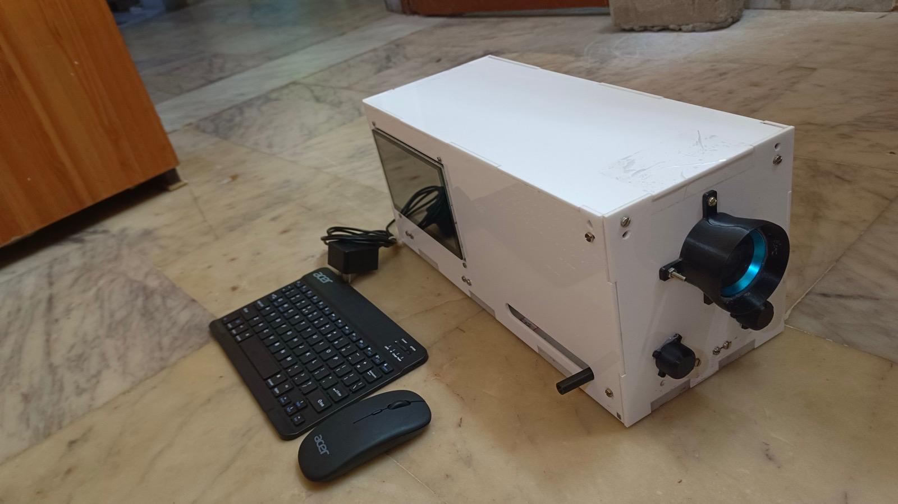
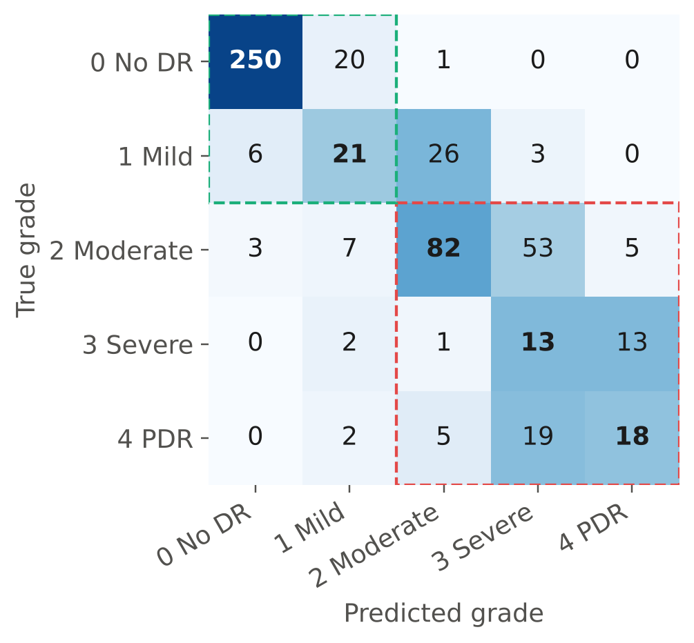
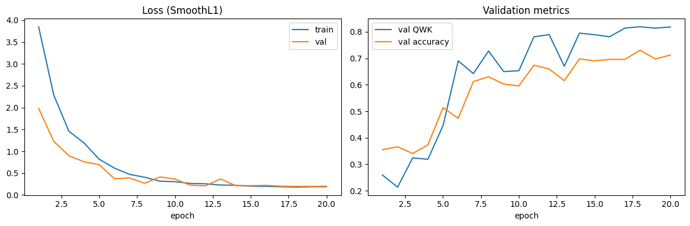
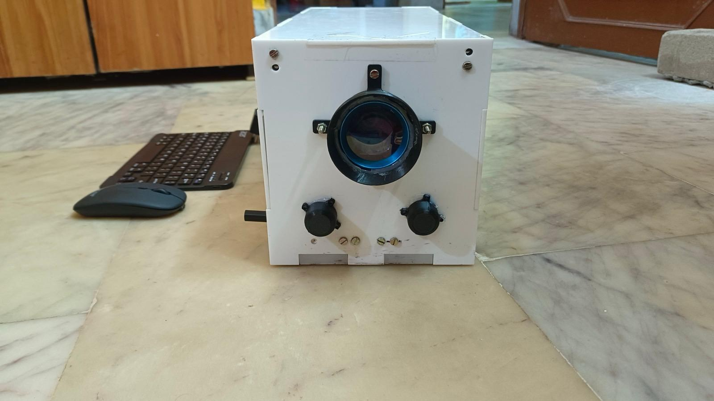
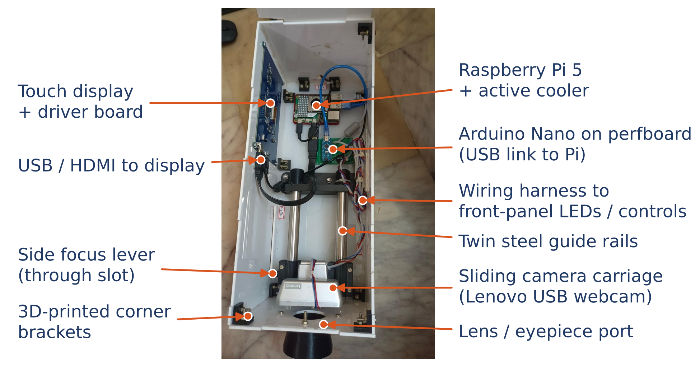
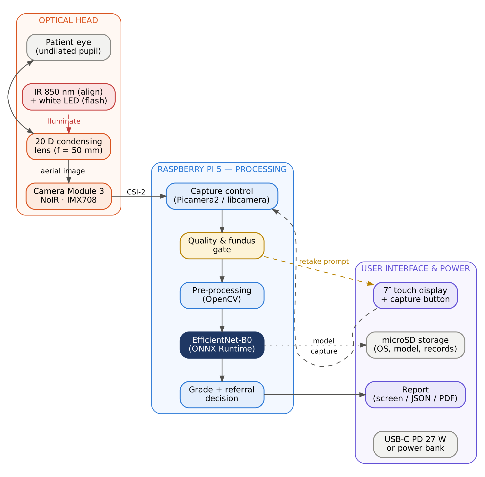
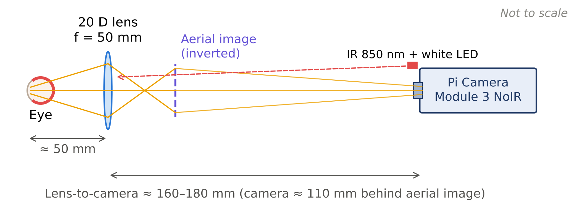

<div align="center">

```
        .-~~~~~~~~~-.
     .'   .-~~~~-.   '.          ____  ____     ____                          _
    /   .'  .--.  '.   \        |  _ \|  _ \   / ___|  ___ _ __ ___  ___ _ __ | |
   |   /   ( () )   \   |       | | | | |_) |  \___ \ / __| '__/ _ \/ _ \ '_ \| |
   |   \    '--'    /   |       | |_| |  _ <    ___) | (__| | |  __/  __/ | | |_|
    \   '.        .'   /        |____/|_| \_\  |____/ \___|_|  \___|\___|_| |_(_)
     '.   '-....-'   .'
        '-.______.-'           AI fundus camera  ·  offline grading  ·  Raspberry Pi 5

   [ eye ] --> ( 20 D lens ) --> [ Pi Camera NoIR ] --> [ gate ] --> [ EfficientNet-B0 ] --> grade 0-4
```

# AI-Based Portable Fundus Camera for Diabetic Retinopathy Screening

**Capture the retina. Grade diabetic retinopathy on the device. No internet needed.**

[](https://colab.research.google.com/github/Omm-Sanjog/DR-Retinopathy-Fundus-Camera-/blob/main/training/DR_Fundus_Training.ipynb)




*Prototype v1 — acrylic enclosure, front eyepiece mount, side display, rail-mounted camera carriage*

</div>

---

> ⚠️ **Research prototype — not a medical device.** This project is a screening *aid* developed as a B.Tech major project. It has not been clinically validated or approved by any regulator (e.g. CDSCO). Do not use it to make decisions about anyone’s eyes.

## 📌 Overview

Diabetic retinopathy (DR) is a leading cause of preventable blindness. India has ~101 million people with diabetes, but routine eye screening reaches only a fraction of them because fundus cameras are expensive, graders are scarce and cloud tele-grading needs connectivity.

This project builds a **low-cost, portable, offline** fundus camera and analysing unit:

- 🔭 **Optics** — a 20 D condensing lens (indirect ophthalmoscopy) + Raspberry Pi Camera Module 3 **NoIR**, with **850 nm IR** alignment and a short white-LED flash
- 🧠 **Model** — **EfficientNet-B0** regression grader (384 × 384) mapped to the 5-level **ICDR** scale with validation-tuned thresholds
- 🛡️ **Safety gate** — rejects blurred, badly exposed and **non-retinal** images *before* grading, and asks for a retake
- 🍓 **Edge** — runs on a **Raspberry Pi 5** with ONNX Runtime; only three Python packages, no PyTorch on the device
- ☁️ **One-click training** — a self-contained Google Colab notebook downloads the data, trains, evaluates, explains (Grad-CAM) and exports the Pi bundle

## 📊 Results (APTOS 2019 held-out test set, n = 550)

| Metric | Result | Target |
|---|---|---|
| Quadratic weighted kappa (tuned thresholds) | **0.877** | ≥ 0.85 ✅ |
| Referable DR sensitivity (grade ≥ 2) | **93.7 %** (95 % CI 89.7–96.2) | ≥ 85 % ✅ |
| Referable DR specificity | **90.8 %** (95 % CI 87.2–93.5) | ≥ 80 % ✅ |
| Referable DR AUC | **0.973** | – |
| Five-class accuracy | 69.8 % | – |
| FP32 ONNX model size / PyTorch parity | 16.0 MB / 2 × 10⁻⁶ | ≤ 20 MB ✅ |
| Time per image on Raspberry Pi 5 (prototype v1) | ≈ 3 s | ≤ 2 s ❌ (optimisation planned) |

<p align="center">
  
  
</p>

Full numbers: [`results/metrics.json`](results/metrics.json) · [`results/classification_report.txt`](results/classification_report.txt) · [`results/training_log.csv`](results/training_log.csv)

### 🔍 Honest findings

- **INT8 was rejected.** Post-training INT8 quantisation shrank the model to 4.8 MB but dropped test QWK from **0.877 → 0.570**. The export step only deploys INT8 if it stays within 0.01 QWK of FP32, so **FP32 is deployed**. Quantisation-aware training is future work.
- **Grad-CAM shows a shortcut risk.** Heat-maps concentrate at image corners/borders rather than lesions, suggesting the model may partly use APTOS acquisition cues (camera/crop differences). APTOS metrics may therefore be optimistic; external validation (Messidor-2, IDRiD, own-device images) is required.
- **Pi latency is ≈ 3 s per image** — above the 2 s target; a persistent model session, multi-threaded ONNX Runtime and quantisation-aware INT8 are planned.
- **Mild DR is hardest** (recall 0.38) — microaneurysms span only 1–2 px at 384 px input.

## 🛠️ Prototype v1 (as built)

<p align="center">
  
  
</p>

- White acrylic enclosure, screw-assembled with 3D-printed corner brackets
- Condensing lens in a 3D-printed front eyepiece mount, two front-panel controls
- Camera on a **carriage sliding on twin steel guide rails**, moved by a side lever → mechanical focus on the aerial image
- Raspberry Pi 5 + active cooler, Arduino Nano co-processor, side-mounted touch display
- v1 uses a **USB webcam** (`--usbcam`); v2 moves to the Camera Module 3 NoIR for IR alignment — see [`hardware/as-built-v1.md`](hardware/as-built-v1.md)

## 🏗️ System

<p align="center"></p>

```
 capture ──► quality gate ──► fundus gate ──► crop → 384 px → Ben Graham → mask ──► EfficientNet-B0 ──► thresholds ──► grade + referral
             (blur, exposure)  (median R/G ≥ 1.6)                                    (ONNX FP32)         0.58 1.08 1.88 2.72
                  │                 │
                  └──── retake ◄────┘
```

| ICDR grade | Meaning | Device output |
|---|---|---|
| 0 | No DR | Re-screen in 1 year |
| 1 | Mild NPDR | Re-screen in 1 year |
| 2 | Moderate NPDR | **Refer to ophthalmologist** |
| 3 | Severe NPDR | **Refer to ophthalmologist** |
| 4 | Proliferative DR | **Refer urgently** |

## 📁 Repository structure

```
DR-Retinopathy-Fundus-Camera-/
├── training/                          # ── model training (Google Colab)
│   ├── DR_Fundus_Training.ipynb       #    one-click: download → train → evaluate → export Pi bundle
│   ├── colab_upload_and_analyse.py    #    Colab cell: upload a photo and grade it
│   └── runs/
│       └── DR_Fundus_Training_run_2026-10-31.ipynb   # executed run with all outputs (T4 GPU)
├── raspberry-pi/                      # ── on-device software
│   ├── pi_inference.py                #    gates + pre-processing + ONNX inference + CLI (--usbcam / --camera)
│   ├── config.json                    #    tuned thresholds, quality limits, test metrics
│   ├── requirements.txt               #    onnxruntime, opencv-python-headless, numpy
│   ├── README.md                      #    Pi setup guide
│   └── models/                        #    put dr_model_fp32.onnx here
├── hardware/                          # ── physical device
│   ├── BOM.csv                        #    bill of materials (₹39,390)
│   ├── as-built-v1.md                 #    prototype v1 vs design
│   ├── optics.md                      #    20 D indirect-ophthalmoscopy calculations
│   ├── wiring.md                      #    pin map, LED drivers, power budget
│   └── cad/                           #    enclosure files
├── results/                           # ── metrics.json, training log, confusion matrix, plots
├── docs/                              # ── documentation
│   ├── report/                        #    Major Project-1 report (.docx)
│   ├── paper/                         #    IEEE conference paper (.docx)
│   ├── figures/                       #    block diagram, circuit, flowcharts, Gantt, BOM chart …
│   ├── photos/                        #    prototype v1 photographs
│   ├── SETUP.md                       #    full setup guide (Colab + Raspberry Pi)
│   └── HARDWARE.md                    #    hardware overview
├── scripts/figures/                   # ── regenerate every figure in the report & paper
├── assets/                            # ── synthetic sample image for testing
├── requirements.txt                   # training / development dependencies
├── CITATION.cff · LICENSE · README.md
```

## 🚀 Quick start

### 1. Train in Google Colab (≈ 25 min on a free T4)

1. Click **Open in Colab** above (or upload `training/DR_Fundus_Training.ipynb`).
2. `Runtime → Change runtime type → T4 GPU` (CPU also works — the notebook switches to lighter settings).
3. `Runtime → Run all`. APTOS 2019 is downloaded automatically from Hugging Face — no Kaggle key needed.
4. At the end **`dr_pi_bundle.zip`** downloads, containing the ONNX models, `config.json` and `pi_inference.py`.

### 2. Run on a Raspberry Pi 5

```bash
git clone https://github.com/Omm-Sanjog/DR-Retinopathy-Fundus-Camera-.git
cd DR-Retinopathy-Fundus-Camera-/raspberry-pi
python3 -m venv venv && source venv/bin/activate
pip install -r requirements.txt
# copy dr_model_fp32.onnx from dr_pi_bundle.zip into raspberry-pi/models/
python3 pi_inference.py ../assets/sample_fundus_synthetic.png
python3 pi_inference.py --camera          # Pi Camera Module (rpicam-still), then analyse
python3 pi_inference.py --usbcam          # USB webcam (prototype v1), then analyse
python3 pi_inference.py eye.jpg --json    # machine-readable output
```

Example output (illustrative — values depend on the image):

```
Image      : eye.jpg
Grade      : 2 - Moderate  (score 2.104)
Referable  : YES - refer to an ophthalmologist
Inference  : ### ms  [dr_model_fp32.onnx]
Note: prototype screening aid, not a medical diagnosis.
```

If the photo is not a usable retina image you get `⚠️ Retake recommended: …` with the reason (blurry, too dark, too bright, or not a retina photo).

### 3. Use it from Python

```python
import cv2
from pi_inference import DRModel

model = DRModel()                                   # loads config.json + recommended model
rgb = cv2.cvtColor(cv2.imread("eye.jpg"), cv2.COLOR_BGR2RGB)
print(model.predict(rgb))
# {'grade': 2, 'grade_name': 'Moderate', 'referable': True, 'image_ok': True, 'fundus_rg': 2.41, ...}
```

## 🔧 Hardware

| Part | Purpose |
|---|---|
| Raspberry Pi 5 (8 GB) + active cooler | Processing unit |
| Lenovo 1080p USB webcam (v1) → Camera Module 3 **NoIR** (v2) | Fundus capture |
| 20 D aspheric condensing lens | Indirect ophthalmoscopy optics |
| 4 × 850 nm IR LEDs + 2 × 3000 K white LEDs, 2 × AO3400 MOSFETs | Alignment light + capture flash |
| Waveshare 7″ 1024×600 HDMI capacitive touch display | User interface |
| 27 W USB-C PD supply / 10,000 mAh PD bank | Power (≈ 4.4 h estimated) |

Prototype cost **₹39,390 (≈ ₹40,000)** at Robu.in / retail prices (Nov 2026) — see [`hardware/BOM.csv`](hardware/BOM.csv), [`hardware/wiring.md`](hardware/wiring.md) and [`hardware/optics.md`](hardware/optics.md).

<p align="center"></p>

## 🧪 Method summary

| Step | Details |
|---|---|
| Data | APTOS 2019 — 3,662 graded images (Aravind Eye Hospital, India); stratified 70/15/15 split, seed 42 |
| Pre-processing | Black-border crop → square → 384 px → Ben Graham local-contrast normalisation → circular mask |
| Model | EfficientNet-B0 (ImageNet init), single regression output, dropout 0.3 — 4.01 M params, 1.13 GMACs |
| Training | Smooth-L1 loss, AdamW, one-cycle LR (3e-4), 20 epochs, AMP, best-val-QWK checkpoint |
| Grading | Thresholds tuned on validation to maximise QWK → `[0.58, 1.08, 1.88, 2.72]` |
| Explainability | Grad-CAM |
| Export | ONNX opset 17 (FP32) + static INT8 (QDQ); INT8 used only if ΔQWK ≤ 0.01 |

## 🗺️ Roadmap

- [x] One-click Colab training + evaluation + Pi bundle
- [x] Quality and fundus-image gates
- [x] Optical, electrical and enclosure design
- [x] Prototype v1 built (acrylic enclosure, rail-mounted camera carriage, Pi 5, display)
- [ ] Prototype v2: Camera Module 3 NoIR + IR alignment, hand-held form factor
- [x] On-Pi timing measured (≈ 3 s per image)
- [ ] Reduce on-Pi time to ≤ 2 s; measure light exposure (ISO 15004-2)
- [ ] Remove shortcut cues (border masking, random erasing) and re-check Grad-CAM
- [ ] Quantisation-aware training for an accurate INT8 model
- [ ] Touch-screen app (Odia / Hindi / English)
- [ ] Ethics-approved data collection and validation against ophthalmologist grading
- [ ] External testing on Messidor-2 and IDRiD

## 👥 Team

| Name | Role |
|---|---|
| **Omm Sanjog Barik** ([ORCID](https://orcid.org/0009-0009-4085-8099)) | **Team lead** — system architecture, hardware development, backend & software (training pipeline, on-device inference, quality gates), integration |
| Laganjeet Jena | Hardware development — enclosure, mechanics, wiring, assembly |
| Piyush Raj | GitHub, UI/UX and deployment |
| Riddhi Khanna | GitHub, UI/UX and deployment |
| **Prof. Prasant Kumar Patra** | Supervisor |

School of Electronics Engineering, **KIIT (Deemed to be University)**, Bhubaneswar — Major Project (2026–2027)

## 📚 Citation

If you use this work, please cite it — see [`CITATION.cff`](CITATION.cff) (GitHub shows a **“Cite this repository”** button).

## 🙏 Acknowledgements

- [APTOS 2019 Blindness Detection](https://www.kaggle.com/c/aptos2019-blindness-detection) dataset (Asia Pacific Tele-Ophthalmology Society & Aravind Eye Hospital)
- [PyTorch](https://pytorch.org), [timm](https://github.com/huggingface/pytorch-image-models), [ONNX Runtime](https://onnxruntime.ai), [OpenCV](https://opencv.org)
- B. Y. Shen & S. Mukai, *A Portable, Inexpensive, Nonmydriatic Fundus Camera Based on the Raspberry Pi Computer*, J. Ophthalmol., 2017 — inspiration for the optical head

## 📄 License

Code and design files: [MIT](LICENSE). The APTOS 2019 dataset is **not** included and remains under its own terms of use.

<div align="center">

```
  ~ screen early · refer early · save sight ~
```

</div>
