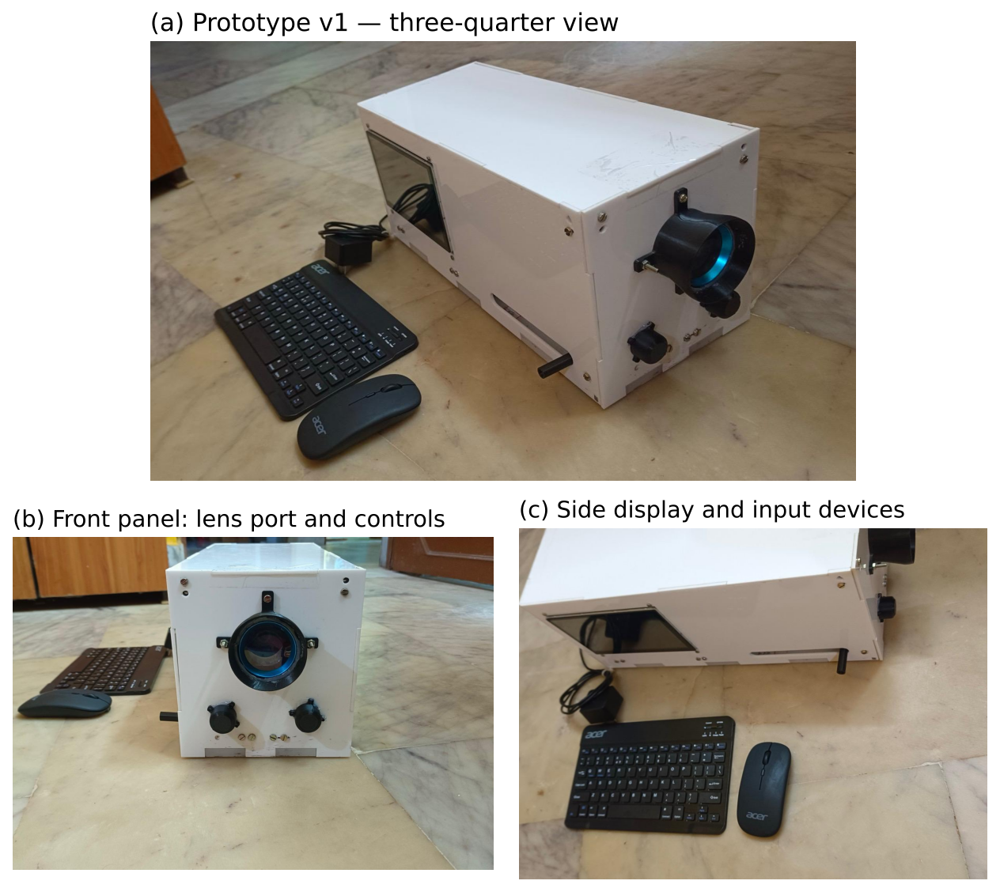
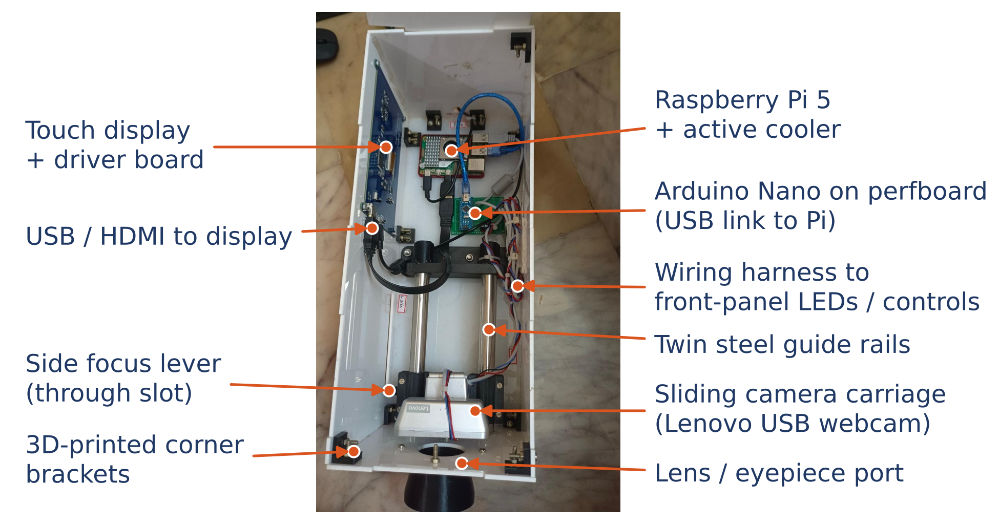

# Hardware overview

## Bill of materials (summary — full list in [`../hardware/BOM.csv`](../hardware/BOM.csv))

| Part | Purpose | ₹ |
|---|---|---|
| Raspberry Pi 5 (8 GB) + active cooler + 27 W PSU | Processing unit | 9,811 |
| Waveshare 7″ 1024×600 HDMI capacitive touch display | User interface | 4,450 |
| 20 D double-aspheric condensing lens | Indirect-ophthalmoscopy optics | 5,000 |
| Lenovo 1080p USB webcam (v1) / Camera Module 3 NoIR (v2) | Fundus capture | 2,500 / 3,379 |
| Arduino Nano + LED driver parts | Front-panel I/O, IR/white LEDs | 1,050 |
| 8 mm rods + LM8UU bearings + SK8 supports | Sliding camera carriage (focus) | 1,200 |
| Acrylic enclosure + 3D-printed parts + fasteners | Housing | 4,400 |
| Power bank, microSD 64 GB, cables, BT keyboard/mouse, shipping | Misc. | 7,600 |
| **Total** | | **39,390 (≈ 40,000)** |

Prices: Robu.in (checked 02/11/2026) for the Raspberry Pi parts and display; others are indicative retail prices.

## Details

- Prototype v1 vs design: [`../hardware/as-built-v1.md`](../hardware/as-built-v1.md)
- Optical calculations: [`../hardware/optics.md`](../hardware/optics.md)
- Wiring, LED drivers, power budget: [`../hardware/wiring.md`](../hardware/wiring.md)

