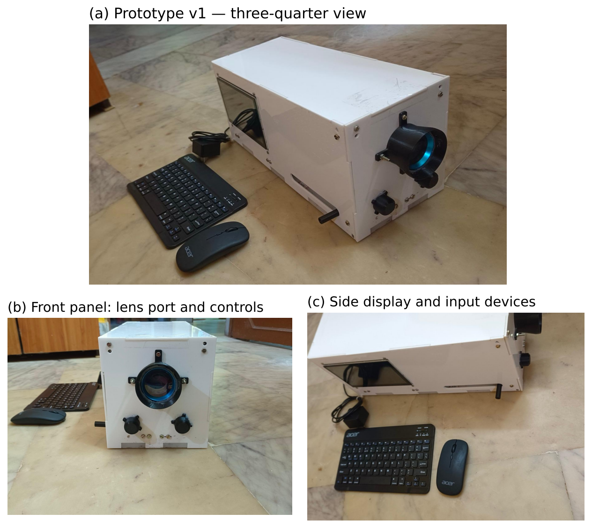
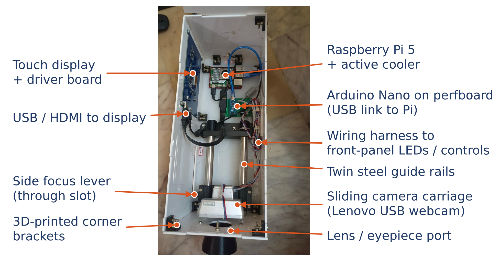

# Prototype v1 — as built (October 2026)



| Subsystem | Design | Prototype v1 (as built) |
|---|---|---|
| Enclosure | Hand-held 3D-printed tube + housing | Table-top white acrylic box, screw-assembled, 3D-printed corner brackets |
| Camera | Camera Module 3 NoIR (CSI-2) | Lenovo USB webcam on a sliding carriage |
| Focusing | Autofocus + sliding lens holder | Carriage on twin stainless-steel guide rails, moved by a side lever |
| Optics | 20 D condensing lens | Condensing lens in a 3D-printed front eyepiece mount *(confirm power)* |
| I/O control | Pi 5 GPIO PWM → LED MOSFETs | Pi 5 + Arduino Nano co-processor on perfboard (USB) *(confirm role)* |
| Front controls | Capture push-button | Two rotary controls on the front panel *(confirm function)* |
| Display / input | 5″ touch display | Side-mounted touch display; Bluetooth keyboard and mouse |
| Power | USB-C PD supply / power bank | External mains adapter (SELV output) |



## Running with the USB webcam

```bash
cd device && bash install.sh           # once
# then double-click the FundusScan icon (USB camera is the default), or:
./run.sh --usbcam                      # camera index 0; use --usbcam 1 for a second camera
```

## Planned for v2

- Replace the USB webcam (likely has an IR-cut filter) with **Camera Module 3 NoIR** → IR alignment preview
- Repeat the sampling calculation (`optics.md`) for the actual camera
- Measure light exposure at the eye plane (ISO 15004-2) before imaging anyone
- Battery operation (USB-C PD power bank) and hand-held form factor
